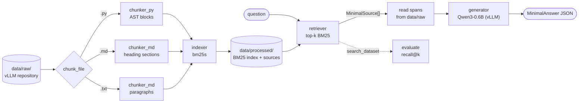

*This activity has been created as part of the 42 curriculum by lmuny.*

# RAG against the machine

> *Will you answer my questions?*

A small, fully local **Retrieval-Augmented Generation** system that answers questions about the
[vLLM 0.10.1](https://github.com/vllm-project/vllm) codebase. It indexes ~2,000 Python and Markdown
files, finds the snippets that answer a question in milliseconds, and hands them to
**Qwen/Qwen3-0.6B** to write a grounded answer.

| | |
|---|---|
| **Retrieval** | BM25 (`bm25s`) over structure-aware chunks |
| **Generation** | Qwen/Qwen3-0.6B through vLLM |
| **Recall@5** | **0.84** on docs questions · **0.59** on code questions |
| **Indexing** | ~3 s for the whole corpus (26,747 chunks) |
| **Search** | < 1 s for a 100-question dataset |

---

## Table of contents

1. [Description](#description)
2. [Instructions](#instructions)
3. [Example usage](#example-usage)
4. [System architecture](#system-architecture)
5. [Chunking strategy](#chunking-strategy)
6. [Retrieval method](#retrieval-method)
7. [Answer generation](#answer-generation)
8. [Performance analysis](#performance-analysis)
9. [Design decisions](#design-decisions)
10. [Challenges faced](#challenges-faced)
11. [Resources](#resources)

---

## Description

A language model only knows what it saw during training. Ask it about a private codebase and it
will either refuse or confidently make something up. Retraining it every time the code changes is
far too expensive, so RAG takes another route: **let the model look things up at answer time**.

This project builds that pipeline end to end, in four stages:

| Stage | What it does here |
|---|---|
| **Indexing** | Split every `.py`, `.md` and `.txt` file of `data/raw/` into chunks of at most 2,000 characters and build a BM25 index under `data/processed/`. |
| **Retrieving** | Score every chunk against a question and return the top-k as source locations (`file_path` + character range). |
| **Augmenting** | Read the text behind those locations and pack as much of it as fits in the model's token budget. |
| **Generating** | Ask Qwen3-0.6B to answer *only* from that context, as structured JSON. |

Retrieval quality is measured with **recall@k**: the share of reference sources found in the top-k
results, where a result counts when it is in the same file and overlaps the reference span with an
IoU of at least 0.05.

---

## Instructions

### Requirements

- Python 3.10 – 3.12
- [uv](https://docs.astral.sh/uv/)
- A CUDA GPU with at least 6 GB for answer generation (vLLM). Indexing, search and evaluation run
  on CPU only.
- Several GB of free disk space for the deep-learning stack and the model weights.

### Installation

```bash
make install        # uv sync, with the virtual environment on /goinfre
```

The `Makefile` keeps the virtual environment and the uv cache on `/goinfre` (`.venv` is a symlink),
so the multi-gigabyte install never fills the home partition. Outside 42, plain `uv sync` works too.

### Expected data layout

```
data/
├── raw/vllm-0.10.1/                    # the corpus to index
├── processed/                          # built by `index`
├── datasets/
│   ├── UnansweredQuestions/            # questions only
│   └── AnsweredQuestions/              # questions + reference sources
└── output/
    ├── search_results/<DatasetScope>/
    └── search_results_and_answer/<DatasetScope>/
```

None of these are committed: copy the corpus and the datasets from the project attachments.

### Makefile rules

| Rule | Effect |
|---|---|
| `make install` | Install the dependencies with uv |
| `make run` | Run `python -m src` (prints the CLI help) |
| `make debug` | Run the program under `pdb` |
| `make lint` | `flake8` + `mypy` with the flags required by the subject |
| `make lint-strict` | `flake8` + `mypy --strict` |
| `make clean` | Remove `__pycache__` and `.mypy_cache` |

---

## Example usage

Every command is run as `uv run python -m src <command> [options]`, and `--help` works on each of
them.

| Command | Purpose |
|---|---|
| `index` | Chunk `data/raw/` and save the BM25 index |
| `search` | Top-k sources for one question |
| `search_dataset` | Top-k sources for every question of a dataset, saved as JSON |
| `evaluate` | Recall@1/3/5/10 of saved results against a reference dataset |
| `answer` | Search, then generate an answer for one question |
| `answer_dataset` | Generate answers for a saved `search_dataset` output |

### Full pipeline

```bash
# 1. Index the corpus once
uv run python -m src index --max_chunk_size 2000

# 2. Search a whole dataset
uv run python -m src search_dataset \
    --dataset_path data/datasets/UnansweredQuestions/dataset_docs_public.json \
    --k 10 \
    --save_directory data/output/search_results/UnansweredQuestions

# 3. Measure recall@k against the reference answers
uv run python -m src evaluate \
    --student_search_results_path data/output/search_results/UnansweredQuestions/dataset_docs_public.json \
    --dataset_path data/datasets/AnsweredQuestions/dataset_docs_public.json

# 4. Generate the answers
uv run python -m src answer_dataset \
    --student_search_results_path data/output/search_results/UnansweredQuestions/dataset_docs_public.json \
    --save_directory data/output/search_results_and_answer/UnansweredQuestions
```

### A single question

```bash
uv run python -m src search "How do I enable LoRA adapters?" --k 2
```

```json
{
  "question_id": "13c2a0ba-66ae-4ba9-a708-1f8af727337c",
  "question": "How do I enable LoRA adapters?",
  "retrieved_sources": [
    {
      "file_path": "data/raw/vllm-0.10.1/docs/features/lora.md",
      "first_character_index": 1884,
      "last_character_index": 2072
    },
    {
      "file_path": "data/raw/vllm-0.10.1/docs/features/lora.md",
      "first_character_index": 14487,
      "last_character_index": 15148
    }
  ]
}
```

```bash
uv run python -m src answer "How do I enable LoRA adapters?" --k 5
```

```json
{
  "question_id": "604fa67e-a17e-43d1-8efc-83e844c76d2a",
  "question": "How do I enable LoRA adapters?",
  "retrieved_sources": ["… 5 sources, the first 3 from docs/features/lora.md …"],
  "answer": "To enable LoRA adapters, you can use the `--enable-lora` parameter in the vLLM command-line interface. This allows you to enable handling of LoRA adapters dynamically. Additionally, you can configure other parameters like `--max-lora-rank` to set the maximum rank for LoRA adapters."
}
```

### Bad input never crashes

Every input is validated before use, and every failure prints one readable line instead of a
traceback:

```console
$ uv run python -m src search "   "
[ERROR]: 'query' can't be empty
$ uv run python -m src search lora --k 0
[ERROR]: 'k' should be > 0
$ uv run python -m src search lora --processed_path nope
[ERROR]: Index not found in nope, run 'index' first
$ uv run python -m src search_dataset --dataset_path nope.json
[ERROR]: Can't read nope.json: [Errno 2] No such file or directory: 'nope.json'
```

---

## System architecture



| Module | Role |
|---|---|
| [`src/__init__.py`](src/__init__.py) | The Fire CLI: validates every argument, loads and saves JSON, wires the stages together. |
| [`src/models.py`](src/models.py) | Pydantic models exchanged between stages (`MinimalSource`, `RagDataset`, `StudentSearchResults`, …). |
| [`src/chunker_md.py`](src/chunker_md.py) | Markdown and plain-text chunking. |
| [`src/chunker_py.py`](src/chunker_py.py) | Python chunking along the syntax tree. |
| [`src/indexer.py`](src/indexer.py) | Walks the corpus, chunks every file, builds and saves the BM25 index. |
| [`src/retriever.py`](src/retriever.py) | Loads the index once and answers top-k queries. |
| [`src/generator.py`](src/generator.py) | Builds the prompt within the token budget and runs Qwen3 through vLLM. |
| [`src/evaluate.py`](src/evaluate.py) | IoU between two spans, recall@k per question and per dataset. |

The index only stores **where** each chunk is (`file_path`, start, end), never a copy of its text.
When an answer is needed, the text is read back from `data/raw/` at those exact positions, so
the sources given to the model are always the ones reported in the output.

---

## Chunking strategy

Every chunk is a character range of the original file, never a rewritten copy. That keeps
`first_character_index` and `last_character_index` exact, which the grader compares to the
reference spans.

### Markdown: one section at a time

1. **Cut at headings.** Each line starting with `#` opens a new section, except inside fenced code
   blocks, where `# comment` lines are not headings.
2. **Split oversized sections** with a three-level fallback, each level used only when the previous
   one cannot get under `max_chunk_size`:
   1. on blank lines (paragraphs);
   2. on line breaks;
   3. every `max_chunk_size` characters, as a last resort.

   Consecutive pieces are merged greedily, so a chunk stays as large as allowed instead of becoming
   one paragraph per chunk.

A documentation section usually answers one topic, so section boundaries are the natural unit for a
docs question.

### Python: one definition at a time

1. **Parse the file with `ast`** and take every top-level function, async function and class,
   including its decorators.
2. **Cut at their boundaries.** The code between two definitions (imports, constants, module code)
   becomes its own block.
3. **Split oversized blocks** with the same paragraph → line → hard-cut fallback as Markdown.
4. If a file does not parse (`SyntaxError`), it is treated as one block and split by size.

A code question is usually about one function or class, and a chunk that starts at a `def` or a
`class` carries its name, signature and docstring together.

### Plain text

`.txt` files have no reliable structure, so they go straight to the size-based fallback.

---

## Retrieval method

### BM25

Retrieval uses **Okapi BM25**, through the [`bm25s`](https://github.com/xhluca/bm25s) library. For a
query *q* and a chunk *D*:

$$
\text{score}(D, q) = \sum_{t \in q} \text{IDF}(t) \cdot
\frac{f(t, D)\,(k_1 + 1)}{f(t, D) + k_1 \left(1 - b + b \frac{|D|}{\text{avgdl}}\right)}
$$

- **IDF** rewards rare terms: `lora` says much more than `model`.
- **Term-frequency saturation** (`k1`): the tenth occurrence of a word adds far less than the first.
- **Length normalisation** (`b`): a long chunk does not win just by containing more words.

`bm25s` precomputes every score into a sparse matrix at indexing time, so a query is a sum of a few
matrix rows instead of a loop over 26,747 chunks.

### Tokenisation and the file path trick

Both chunks and queries go through the same `bm25s` tokenizer, with English stopwords removed.

Before tokenisation, each chunk is prefixed with **its own file path, made readable**: `/`, `_` and
`.` become spaces. A chunk of `vllm/lora/worker_manager.py` is therefore also indexed under the
words `lora`, `worker` and `manager`. Questions often name the feature or the module they are
about, and the path is frequently the only place where that word appears.

### Ranking

Chunks are sorted by BM25 score and the top-k are returned. Chunks with a score of zero (no word in
common with the query) are dropped, so a nonsensical query returns fewer than k sources, or none,
instead of k random ones.

---

## Answer generation

The generator ([`src/generator.py`](src/generator.py)) turns the retrieved sources into an answer:

1. **Read the sources.** The text behind each retrieved span is read from `data/raw/`.
2. **Fit the token budget.** The context window is 8,192 tokens. After reserving 512 tokens for
   the answer, plus room for the system prompt and the question, sources are added in rank order
   until the next one no longer fits. The best sources are therefore always the ones kept.
3. **Prompt.** A short system prompt tells the model to use only the provided context, to say so
   when the answer is not in it, and to answer in 2 to 4 sentences. Each source is labelled with
   its file path.
4. **Generate in batch.** For a dataset, all prompts are built first and sent to vLLM in a single
   call, which schedules them together on the GPU.
5. **Clean up.** Qwen3's thinking mode is disabled (`enable_thinking=False`), and any leftover
   `<think>…</think>` block is stripped from the output.

Sampling uses `temperature=0.7` and `top_p=0.8`, the values recommended by Qwen for non-thinking
mode.

---

## Performance analysis

All figures below were measured on the public datasets with this repository's own `evaluate`
command (same IoU ≥ 0.05 rule as the moulinette), on a 24-thread machine. The docs dataset has 100
questions and the code dataset 99.

### Recall@k with the default chunk size (2,000 characters)

| Dataset | Recall@1 | Recall@3 | **Recall@5** | Recall@10 | Required @5 |
|---|---|---|---|---|---|
| Docs | 0.620 | 0.810 | **0.840** | 0.870 | 0.80 ✅ |
| Code | 0.354 | 0.485 | **0.586** | 0.667 | 0.50 ✅ |

### Effect of `--max_chunk_size`

| Chunk size | Chunks | Docs @5 | Code @5 | Docs @10 | Code @10 | Indexing |
|---|---|---|---|---|---|---|
| **2000** (default) | 26,747 | **0.840** | 0.586 | **0.870** | 0.667 | 2.6 s |
| 1000 | 39,288 | 0.800 | 0.626 | 0.860 | 0.667 | 2.8 s |
| 500 | 67,135 | 0.830 | **0.646** | 0.840 | **0.707** | 3.2 s |

- **Code benefits from smaller chunks.** A 2,000-character chunk of Python often holds several
  functions, which dilutes the score of the one that matters. Smaller chunks isolate it.
- **Docs prefer larger chunks.** A documentation answer is spread over a whole section, and cutting
  it into small pieces separates the question's keywords from each other.
- **2,000 stays the default**, because it keeps the most margin on docs, the stricter threshold
  (0.84 against 0.80). At 1,000, docs recall@5 lands exactly on the threshold.

### Speed

| Requirement | Limit | Measured |
|---|---|---|
| Index the whole corpus | 5 min | ~3 s |
| Search 200 questions | 90 s | < 1 s for 100 questions, index loading included |
| Answer 100 questions | – | ~47 s on an RTX 4050 Laptop (6 GB), model loading included |
| Answer 1 question | – | ~20 s, almost all of it loading the model |

Loading Qwen3 in vLLM costs a fixed ~20 s, so `answer_dataset` sends every prompt in one batch: the
other 99 answers only add about 27 s.

---

## Design decisions

- **BM25 rather than TF-IDF.** BM25 adds term-frequency saturation and length normalisation, both of
  which matter when chunk sizes vary from a one-line constant to a 2,000-character class.
- **`bm25s` rather than a hand-written BM25.** Eager sparse scoring makes indexing take seconds and
  search take milliseconds, far below the time limits, and the index is saved and reloaded in one
  call.
- **Store positions, not text.** The index keeps only `(file_path, start, end)`. The text is read
  back from the corpus when needed, so reported sources and the text given to the model can never
  drift apart.
- **Structure-aware chunking with greedy merging.** Chunks follow sections and definitions, but
  small neighbours are merged up to the size limit, so the index is not flooded with tiny chunks.
- **Path tokens in the index.** A cheap way to match questions that name a module or feature, at no
  cost to the reported character ranges.
- **The CLI validates everything.** Fire does not enforce type hints (`--k abc` arrives as the
  string `"abc"`), so every command checks its arguments, and every file is validated by its
  pydantic model. One small helper per kind of check keeps each command readable.
- **vLLM is imported lazily.** It is only imported when a model is actually loaded, so `index`,
  `search` and `evaluate` start instantly and work without a GPU.
- **Batch generation.** `answer_dataset` sends every prompt to vLLM at once instead of one by one.
- **Keep the question IDs.** `search_dataset` copies each question's `question_id` from the dataset:
  the grader uses it to match results with reference answers.

---

## Challenges faced

| Challenge | Solution |
|---|---|
| **Questions and code use different words.** A question may paraphrase an idea or quote an identifier. | Index the readable file path with each chunk, and keep chunks aligned on whole sections and definitions so identifiers, docstrings and comments stay together. |
| **`#` means two things in Markdown.** A `# comment` inside a fenced code block is not a heading. | Track whether the scanner is inside a code fence before treating a line as a heading. |
| **Some sections or functions exceed 2,000 characters**, and a single over-long source invalidates the whole output. | Paragraph → line → hard-cut fallback, so every chunk is guaranteed to fit. |
| **Some Python files do not parse.** | Catch `SyntaxError` and fall back to size-based splitting for that file. |
| **Exact character offsets.** One shifted index breaks the IoU match with the reference. | Chunks are computed as ranges of the original text and never rewritten, so offsets are exact by construction. |
| **The context window is small.** | Add sources in rank order and stop as soon as the next one does not fit the token budget. |
| **Qwen3 "thinks" out loud** by default. | Disable thinking in the chat template and strip any leftover `<think>` block. |
| **vLLM 0.10.1 breaks with transformers 5** (`Qwen2Tokenizer has no attribute all_special_tokens_extended`): vLLM sets no upper bound, so uv installed the latest major version. | Pin `transformers>=4.55,<5` in `pyproject.toml`. |
| **Out of GPU memory at startup on a 6 GB GPU.** vLLM warms up its sampler with 256 parallel requests by default. | Cap `max_num_seqs` at 64. With ~8k-token prompts and a 33k-token KV cache, only ~4 requests run at once anyway, so nothing is lost. |
| **The CLI must never crash**, even on `k=0`, an empty query, a missing file or malformed JSON. | Validate every argument, catch file and validation errors in shared helpers, print one-line errors. |

---

## Resources

### References

- Lewis et al., [*Retrieval-Augmented Generation for Knowledge-Intensive NLP Tasks*](https://arxiv.org/abs/2005.11401), NeurIPS 2020: the paper that introduced RAG.
- Robertson & Zaragoza, [*The Probabilistic Relevance Framework: BM25 and Beyond*](https://www.staff.city.ac.uk/~sbrp622/papers/foundations_bm25_review.pdf), 2009.
- Manning, Raghavan & Schütze, [*Introduction to Information Retrieval*](https://nlp.stanford.edu/IR-book/), chapters 6 (TF-IDF) and 11 (BM25).
- Lù, [*BM25S: Orders of magnitude faster lexical search via eager sparse scoring*](https://arxiv.org/abs/2407.03618), 2024, and the [`bm25s` repository](https://github.com/xhluca/bm25s).
- [vLLM documentation](https://docs.vllm.ai/) and the [Qwen3-0.6B model card](https://huggingface.co/Qwen/Qwen3-0.6B).
- [Python `ast` module](https://docs.python.org/3/library/ast.html), [Pydantic](https://docs.pydantic.dev/), [Python Fire](https://github.com/google/python-fire/blob/master/docs/guide.md), [tqdm](https://tqdm.github.io/).

### How AI was used

[Claude Code](https://claude.com/claude-code) (Anthropic) was used as a tutor and reviewer:

- **Learning:** explanations of Python Fire, pydantic models and serialisation, `uuid`, and why
  type hints are not enforced at runtime.
- **Code review:** step-by-step reviews of the CLI as it was written by hand (argument
  validation, `try/except` scope, flake8 and mypy issues).
- **Code:** the docstrings
- **Documentation:** This README, including the chunk-size benchmark.
